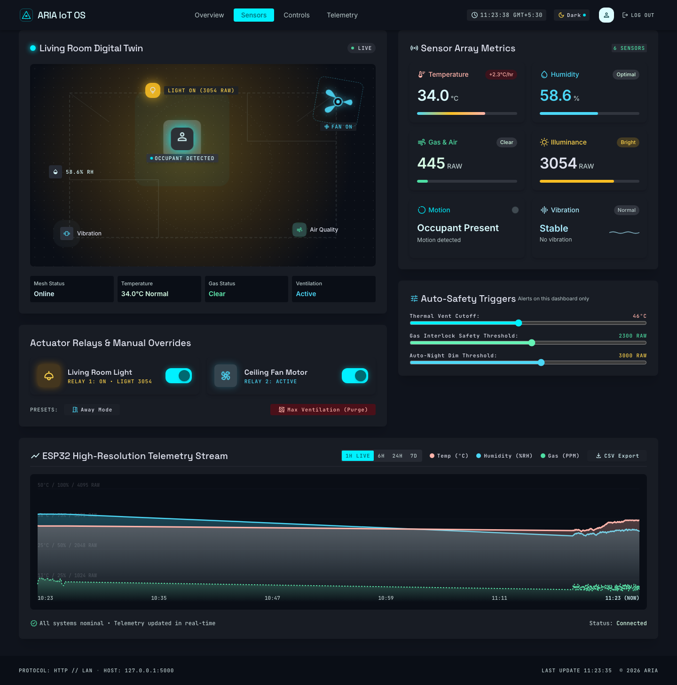

# ARIA — Adaptive Room Intelligence & Automation



**ARIA** is a full-stack IoT home/room automation system. It monitors environmental conditions (temperature, humidity, air quality, motion, light) via an ESP32-based sensor node, and allows automation and remote control of actuators (LED, fan) through a locally-hosted web dashboard.

Unlike commercial smart-home ecosystems (Google Home, Alexa, SmartThings), ARIA does not rely on a third-party cloud server. All sensor data, processing, and control logic stay on infrastructure you own, ensuring absolute privacy and zero subscription costs.

---

## 🌟 Key Features

- **Privacy-First & Cloud-Free:** No third-party server ever sees your data. Everything runs on your local network.
- **Edge-First Automation:** Critical automation logic runs locally on the ESP32 (e.g., immediate response to high gas levels), ensuring safety even if the hub goes offline.
- **Remote Access:** Control your home from anywhere via a secure, private VPN mesh (Tailscale/WireGuard), without opening ports on your router.
- **Beautiful Dashboard:** A sleek, modern React dashboard (Vite + Chart.js) for monitoring real-time sensor data and toggling actuators.
- **Automated Data Retention:** Built-in cleanup jobs ensure your database doesn't grow unbounded over time.

---

## 🛠️ Tech Stack

- **Frontend:** React, Vite, Chart.js, TailwindCSS (for modern glassmorphism UI)
- **Backend (Hub):** Python, Flask, SQLite, zeroconf (mDNS)
- **Firmware (Edge Node):** ESP32, C++ (Arduino framework)
- **Remote Access:** Tailscale

---

## 🔌 Hardware Requirements

- **ESP32** (Core microcontroller)
- **DHT22** (Temperature & Humidity Sensor)
- **MQ-135** (Gas / Air Quality Sensor)
- **LDR** (Light Dependent Resistor with a voltage-divider circuit)
- **PIR / IR Sensor** (Motion Detection)
- **SW-804** (Vibration Sensor)
- **L298N Motor Driver** (To drive the DC motor)
- **LED & Small DC Motor** (Actuators)

---

## 🚀 Quick Setup Guide

For full details, please check out the `SETUP.md` and `ARIA_project_context.md` files.

### 1. Backend (Flask Hub)

Run the backend on an always-on device like a laptop, Raspberry Pi, or mini-PC.

```bash
cd backend
python3 -m venv venv
# Windows: venv\Scripts\activate
source venv/bin/activate
pip install -r requirements.txt

# Run the server
python app.py
```
> **Note:** The backend serves at `http://localhost:5000` and registers `aria.local` via mDNS.

### 2. Frontend (React Dashboard)

```bash
cd frontend
npm install
cp .env.example .env # Ensure VITE_API_BASE points to your backend
npm run dev
```

### 3. Firmware (ESP32)

1. Open `firmware/ARIA_firmware.ino` in the Arduino IDE.
2. Install the necessary libraries: **WiFiManager**, **DHT sensor library**, **ArduinoJson**.
3. Calibrate `GAS_SAFETY_THRESHOLD` based on your MQ-135's readings in normal air.
4. Upload the sketch to your ESP32.
5. On the first boot, connect to the `ARIA-Setup` Wi-Fi network with your phone to provide your home network credentials. 

### 4. Remote Access (Optional)
To access the dashboard remotely without opening ports:
1. Install **Tailscale** on both the device hosting the backend and your phone.
2. Log in to the same Tailscale account.
3. Access the frontend using the backend device's Tailscale IP (e.g., `http://100.x.x.x:5173`).

---

## 👥 Project Team
**Team:** Shine Daniel, Roshan VN, Ryyan Safar  
**Faculty Guide:** Ms. Seema Safar  
**Department:** Electronics & Communication Engineering, RSET, Kochi (CS Minor Project, 2026–27)
